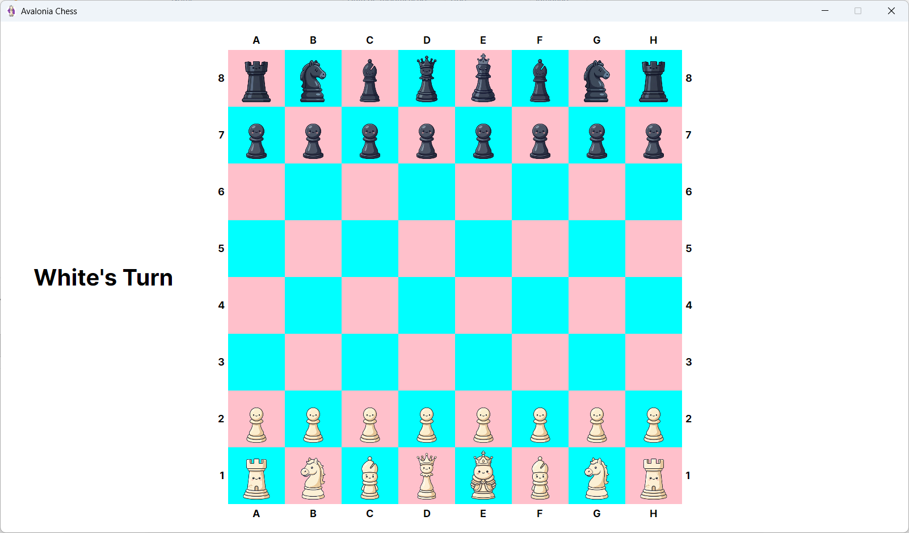

# Avalonia Chess



A lightweight, cross-platform 2-player chess game built with [.NET 10](https://dotnet.microsoft.com/) and [Avalonia UI](https://avaloniaui.net) (version **12.1.6**).

---

## Overview

Avalonia Chess is a desktop chess game designed for two players sharing a single screen (local multiplayer). The board and gameplay are driven entirely via mouse interactions, featuring dynamic turn indicators, piece movement validation, green tile move highlights, and match restart capabilities.

---

## Features

- **Standard 8x8 Chessboard**:
  - Full board layout featuring rank (1–8) and file (A–H) coordinate annotations.
  - Alternating stylized board square colors with responsive image asset scaling.
- **Encapsulated Piece Mechanics**:
  - Each piece's behavior is modeled in its own dedicated class implementing customized movement and capture calculations:
    - **Pawn (`Pawn.cs`)**: Single-square advances, two-square opening sprints from the starting rank, diagonal captures, and automatic promotion to Queen upon reaching the opposing back rank.
    - **Rook (`Rook.cs`)**: Continuous orthogonal sliding and captures along ranks and files.
    - **Knight (`Knight.cs`)**: Distinctive 8-way L-shaped leaping moves capable of jumping over intervening pieces.
    - **Bishop (`Bishop.cs`)**: Continuous diagonal sliding and captures.
    - **Queen (`Queen.cs`)**: Omnidirectional sliding combining orthogonal and diagonal paths.
    - **King (`King.cs`)**: 1-square movement in all directions, standard captures, and castling support (both kingside and queenside with unmoved rooks).
- **Interactive Mouse Controls & Move Highlighting**:
  - Click on any piece belonging to the active team to calculate and display valid destination squares highlighted as **green tiles**.
  - Clicking on a highlighted green tile executes the move, updates board state, and clears highlights.
  - Clicking another friendly piece switches the active selection; clicking an invalid square or clicking the same piece deselects it.
- **Turn-Based System**:
  - Enforces alternating turns, with **White** always taking the opening move.
  - Prominent side indicators display **"White's Turn"** on the left side and **"Black's Turn"** on the right side, hiding automatically when it is not that player's turn.
- **Game Over & Replay Functionality**:
  - Capturing the opposing King ends the game and updates the side display to announce the winner (**"White Wins!"** or **"Black Wins!"**).
  - A dedicated **"PLAY AGAIN"** button appears directly beneath the winning team's text, allowing players to reset the board, restore initial pieces, and immediately start a new match.
- **Optimized Asset Pipeline**:
  - High-resolution SVG-derived PNG sprites loaded via Avalonia's `AssetLoader` with memory-cached bitmaps (`_bitmapCache`) to avoid redundant disk I/O and reduce GC pressure.

---

## Project Structure

```
avalonia-chess/
├── AvaloniaChess/
│   ├── assets/             # Chess piece sprites and application icons
│   ├── App.axaml           # Application XAML definitions and Fluent theme
│   ├── App.axaml.cs        # Desktop lifetime initialization
│   ├── AppLogic.cs         # Core game logic, state management, and UI orchestration
│   ├── MainWindow.axaml    # Chessboard grid, coordinates, and side turn panels
│   ├── MainWindow.axaml.cs # Code-behind hooking window load events to AppLogic
│   ├── Program.cs          # Application bootstrapper and builder setup
│   ├── PieceColor.cs       # Team color enumeration (White / Black)
│   ├── Position.cs         # Immutable 2D board coordinates record struct
│   ├── Piece.cs            # Abstract base piece class with ray-casting utilities
│   ├── Pawn.cs             # Pawn movement and capture logic
│   ├── Rook.cs             # Rook movement and capture logic
│   ├── Knight.cs           # Knight jumping movement and capture logic
│   ├── Bishop.cs           # Bishop diagonal movement and capture logic
│   ├── Queen.cs            # Queen sliding movement and capture logic
│   └── King.cs             # King movement, capture, and castling logic
├── AGENTS.md               # AI agent architectural and security guidelines
├── AssemblyInfo.cs         # Information about the binaries (project title, version, etc.)
├── AvaloniaChess.sln       # Visual Studio solution file
├── unix_builder.sh         # Build automation script for Linux / macOS
├── windows_builder.bat     # Build automation script for Windows
├── README.md               # Project documentation
└── splash.png              # App screenshot
```

---

## Technical Specifications

- **Target Framework:** .NET 10 (`net10.0`)
- **Language Version:** C# 14
  - Primary constructors across piece classes and logic controllers.
  - File-scoped namespaces and target-typed collection expressions (`[]`).
  - Read-only record struct (`Position`) for zero-allocation board coordinate operations.
  - Comprehensive XML documentation comments on all classes, methods, and non-local members.
- **UI Framework:** Avalonia UI 12.1.6 (`FluentTheme`, `InterFont`)
- **Architecture:** Modular, loosely-coupled event-driven UI and board logic.

---

## Requirements

- **CPU:** x64 or ARM64 architecture
- **Operating System:** Windows, Linux, or macOS
- **SDK:** [.NET 10 SDK](https://dotnet.microsoft.com/en-us/download/dotnet/10.0)

> **NOTE:** Installing Visual Studio is optional. The project can be fully built, tested, and run directly via the [.NET CLI](https://learn.microsoft.com/en-us/dotnet/core/tools/) or any code editor (such as VS Code, JetBrains Rider, or Antigravity).

---

## Building and Running

### Using Command Line (.NET CLI)

To build the project for your active environment:
```bash
dotnet build AvaloniaChess.sln
```

To run the game:
```bash
dotnet run --project AvaloniaChess/AvaloniaChess.csproj
```

To publish a self-contained release executable for your specific platform (e.g., Windows x64):
```bash
dotnet publish AvaloniaChess/AvaloniaChess.csproj -c Release -r win-x64 --self-contained
```

### Using Automated Builder Scripts

#### Windows:
1. Double-click `windows_builder.bat` (or run it from a Command Prompt / PowerShell).
2. Enter the option ID corresponding to your target platform and architecture:
   - `[1]` Windows X64
   - `[2]` Windows ARM64
   - `[3]` Linux X64
   - `[4]` Linux ARM64
   - `[5]` MacOSX X64
   - `[6]` MacOSX ARM64

#### Linux / macOS:
1. Open a terminal in the project's root folder.
2. Grant execution permissions if needed:
   ```bash
   chmod +x ./unix_builder.sh
   ```
3. Run the script:
   ```bash
   ./unix_builder.sh
   ```
4. Enter your desired target platform option ID.
